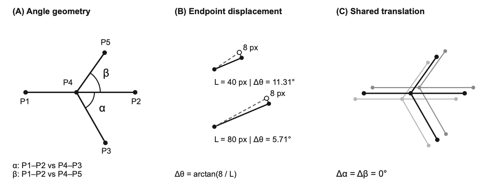
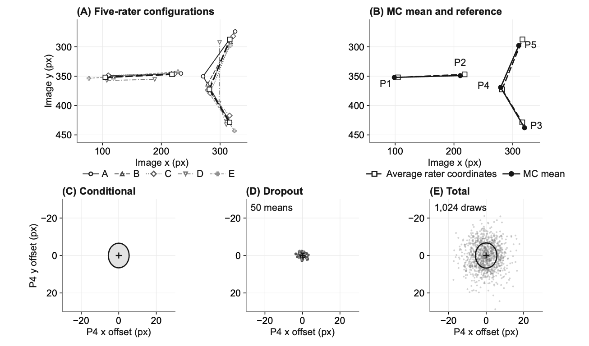
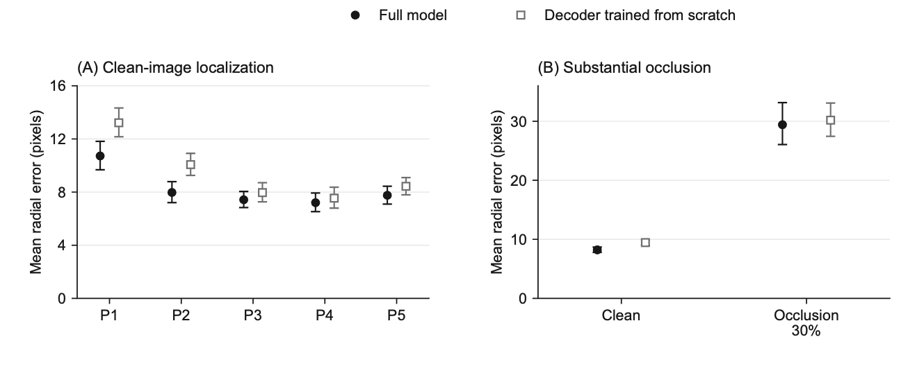
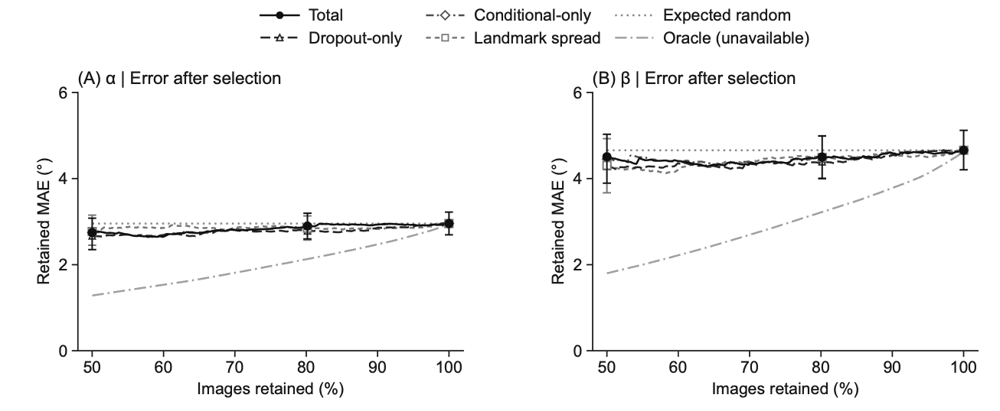
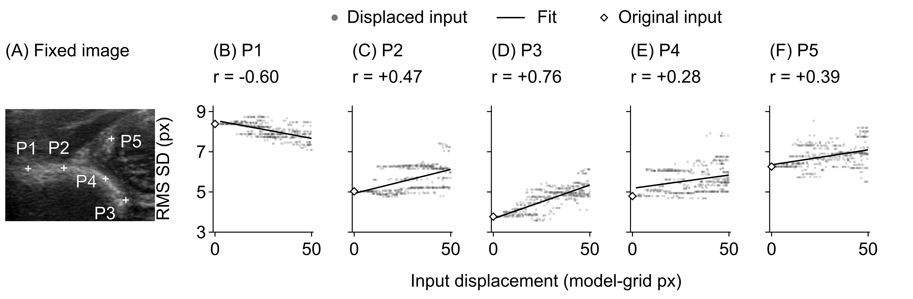
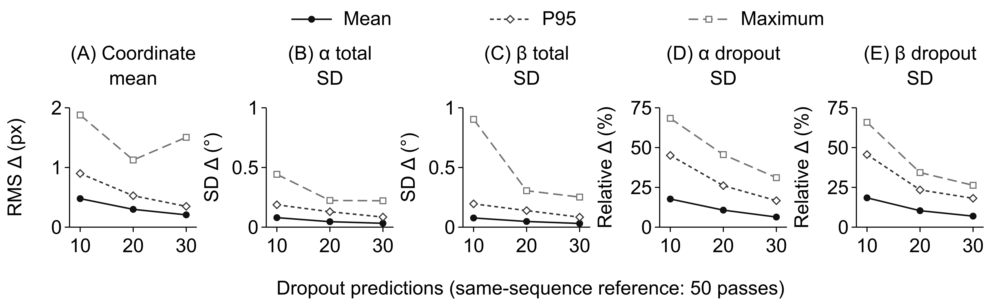

> Public aggregate research record. Source figure, table, equation and reference numbering is retained from the full manuscript. See [provenance notes](provenance_notes.md) for the current interpretation of internal evaluation and sampling sensitivity.

# Extended experiments and complete aggregate results

**Unpublished author-review record.** The material below preserves the frozen supplementary Sections S1–S13 and S16–S17, including all aggregate tables and figure captions. The source numbering is retained for traceability. The package contains finished manuscript figure composites, not original research image files or per-image annotations.

These records document existing experiments. They do not replace necessary methods or results in the main manuscript, establish external validation, or demonstrate clinical review benefit. The 100/142 rescaling analysis uses an internally evaluated cohort; the source author comments document its earlier model-selection use.

Figures with ultrasound panels are the already composed manuscript illustrations. Public redistribution rights and metadata must be reviewed before release. Research image access, trained-parameter access and software/data licensing remain separate author decisions.

## S1. Scope and Reproducibility

This supplement provides the complete model objectives, derivations and results for the coordinate-to-angle uncertainty analysis. Sections S4–S6 describe the predictive distribution, controlled covariance comparison and image-selection metrics. Section S13 reports the separate Stage 1 input-selection reconstruction study. Section S8 retains additional baseline model summaries. Sections S16–S17 provide interval-rescaling and variance-component analyses. Reference numbers follow the main manuscript bibliography.

BatchNorm statistics were reset and re-estimated by cumulative averaging on 2,180 training images (545 minibatches of four), with dropout and photometric augmentation disabled. With weights and BatchNorm fixed, 50 dropout predictions per clean image quantified variability in all five landmarks. The full model's fixed Stage 1 decoder has no active dropout; Comparator also samples dropout in its trained decoder.

Both models were evaluated with stored and training-re-estimated normalization statistics on clean, blurred, speckled and occluded images (16 combinations). Monte Carlo (MC) dropout was used only for the two clean-image evaluations with re-estimated statistics; the other combinations used dropout-disabled inference.

Table S1 describes the training and evaluation settings. Table S2 identifies the evaluated model weights and source files. Section S15 gives the full training objectives, and Section S13 reports the separate reconstruction results.

**TABLE S1 — ARCHITECTURE AND OPTIMIZATION INFORMATION**

| Item | Value |
| --- | --- |
| Input / backbone | $448 \times  448$ / Swin Tiny |
| Latent representation | $12$ tokens; dimension $64$; $256$ codes |
| Encoder / decoder | $8$ Mixer blocks, width $384$ / $3$ blocks, width $256$ |
| Stage 1 optimizer | AdamW; batch $44$; initial LR $0.0003$; weight decay $0.005$ |
| Stage 1 schedule | Budget $500$ epochs; selected epoch 152 |
| Stage 1 transition | Continuous warm-up; quantization transition epochs $40$–$100$; final quantization weight $4$ |
| Stage 1 variance | Log variance clamp $[-14, 4]$; edge variance offset $0.000001$ |
| Stage 2 architecture | Width $192$; $6$ heads; $4$ decoder layers |
| Stage 2 optimizer | Initial LR $0.0002$; weight decay $0.01$; Adam $betas$ $0.9$/$0.999$ |
| Stage 2 schedule | Cosine, ${T}_{\max }$ $400$, minimum LR $0.000001$; selected epoch 386 |
| Evaluation dropout | $0.3$ |
| Stage 2 training batch | Full: 60; comparator: 4 |
| Label smoothing / coordinate loss | $0.15$ / $Smooth-L1 beta 2$ |
| Stage 2 initial loss weights | Token / point / angle: 1 / 5 / 2 |
| Selection: decoder trained from scratch | Epoch 147 |
| Evaluation BatchNorm estimation | 2,180 training images; 545 batches of 4 |
| Evaluation software | Python 3.12.14; PyTorch 2.8.0; torchvision 0.23.0; timm 1.0.19 |
| Dropout evaluation | $50$ dropout predictions/image |

[CSV](../tables/table_S01.csv) · [standalone table](../tables/table_S01.md)

Table S1 summarizes the training and evaluation settings. Evaluation dropout is fixed at 0.3.

The full model uses initial token, coordinate and angle coefficients of 1, 5 and 2. The comparator uses initial coordinate and angle coefficients of 5 and 2, with variance-likelihood coefficient 0.1. Both Stage 2 models use an initial learning rate 0.0002, weight decay 0.01, Adam momentum coefficients 0.9 and 0.999, and a 400-epoch cosine schedule with minimum learning rate 0.000001.

**TABLE S2 — SHA-256 IDENTIFIERS FOR MODELS AND EVALUATION FILES**

| Artifact | SHA-256 |
| --- | --- |
| Stage 1 | 7c102bdd725accd4edb3b6560537fd64 f2aa3d31bd4bcc7cbb50bd686c8c8624 |
| Stage 2 full | 11ce7c399e9dc7d035d1d4975f963d1c fc6833e2b6282af90a87a3057652451a |
| Stage 2: decoder trained from scratch | 77f6e944e9eb39847ab61c36510fb665 229a9d3388ba3a34076006528786c67a |
| Training image list | eb85a2207976dfb7158970f22081fa8e a0b6f69daeebec474b6a0e220a5263cf |
| Validation image list | e4f328262ad02ec9af2a7437a5d781b9 63e0debd6a0334707c3155a69f23a6e6 |
| Evaluation code | 479037c33549df6ce3941947b55fc889 bfab258d7a570c2aa9549341517daf10 |

[CSV](../tables/table_S02.csv) · [standalone table](../tables/table_S02.md)

The recorded timing measurements combine concurrent workloads, file operations and diagnostic calculations. They are excluded from clinical latency claims.

## S2. Rater Annotations and Training Targets

Ethics review and consent

This study retrospectively analyzed existing infant hip ultrasound images and landmark annotations.

The Institutional Review Board of Chang Gung Memorial Hospital approved this retrospective study (201902257B0C501) and waived informed consent from parents or legal guardians. The authors confirmed that the de-identified ultrasound examples may be published.

The dataset contains 2,422 unique image files and 2,422 unique decoded RGB pixel arrays. Exact-identity checks found no duplicates across the training and evaluation partitions. The authors confirmed separation of patients and examinations and no overlap with the earlier institutional cohort. Near-duplicate frames and patient-level linkage require separate source records.

All 2,422 images have annotations from raters A and B. Raters C–E also annotated a class-stratified 200-image subset (quotas of 100/50/30/20 across four recorded categories; 186 training, 14 validation). Its category frequencies differ from the full collection. The recorded categories reflect geometric alpha-angle strata rather than final clinical disease diagnoses. Repeated landmark annotations supply the training targets and reference measurements described in main Section II-A.

Stage 1 learns the landmark representation and coordinate decoder from annotations. Each valid target-rater annotation contributes one training loss term. For each target annotation, the encoder input is sampled uniformly from all available rater annotations of the same image, including the target rater's annotation. Two-rater and five-rater images therefore contribute two and five loss terms, respectively. The separate reconstruction experiment in Section S13 compares this rule with using the target rater's annotation as the encoder input. Both training conditions use the available annotations. Stage 2 predicts the learned landmark representation from the ultrasound image. Its coordinate objective uses the mean of the available rater coordinates, while its token targets remain associated with individual raters. The model with a decoder trained from scratch uses a likelihood target obtained by averaging the available rater coordinates; the full model's Stage 1 likelihood uses individual-rater targets. These distinct targets affect the interpretation of interval-width and coverage comparisons. A separate experiment holding the target definition fixed is required to assess their effect.

The measurement geometry uses three segment vectors in original-image pixels: $u={P}_{2}-{P}_{1}$, $v={P}_{3}-{P}_{4}$ and $w={P}_{5}-{P}_{4}$. The iliac baseline is the line through ${P}_{1}$ and ${P}_{2}$; the line through ${P}_{4}$ and ${P}_{3}$ defines alpha with that baseline, and the line through ${P}_{4}$ and ${P}_{5}$ defines beta. Main Fig. 1A illustrates these lines, and main Eq. (5) specifies the unsigned evaluation map. The Stage 2 training objective instead uses directed clockwise angles modulo 360 degrees and their shortest circular differences, as defined in (S20). For each image, twice the alpha difference plus the beta difference is divided by three and multiplied by the mean of the five heuristic landmark weights. The outer angle-loss weight starts at two. The unsigned evaluation angles lie in $[0,180]$ degrees. The directed training objective and unsigned evaluation error are not globally equivalent.

For descriptive inter-rater analysis, each image contributes the mean Euclidean distance over its available unordered rater pairs. Bootstrap resampling keeps all pairs and landmarks from an image together. Table S3 reports this descriptive quantity. It is not a benchmark against anatomical truth, and differences between the two cohorts cannot be interpreted as a causal effect of having more annotators.

For this descriptive comparison, a Euclidean distance is the length of the two-dimensional displacement between two raters' coordinates for the same landmark, measured in original-image pixels. Averaging first over the available unordered rater pairs within each image prevents an image with more raters from contributing more total evaluation weight. The image bootstrap resamples complete images with their landmark and rater records together; it does not resample individual points as independent observations.

**TABLE S3 — DESCRIPTIVE INTER-RATER LANDMARK DISAGREEMENT**

| Landmark | A/B ($n=2,422$) | All pairs, subset ($n=200$) |
| --- | --- | --- |
| ${P}_{1}$ | 16.35 [15.89, 16.81] | 22.25 [21.27, 23.28] |
| ${P}_{2}$ | 15.03 [14.63, 15.42] | 18.03 [17.27, 18.82] |
| ${P}_{3}$ | 12.34 [11.96, 12.72] | 11.59 [10.86, 12.33] |
| ${P}_{4}$ | 11.09 [10.77, 11.41] | 18.90 [18.20, 19.62] |
| ${P}_{5}$ | 14.74 [14.36, 15.13] | 13.92 [13.28, 14.58] |

[CSV](../tables/table_S03.csv) · [standalone table](../tables/table_S03.md)

Values: mean pairwise distance (px) [95% image-bootstrap CI]. Selected five-rater subset; not population representative.

## S3. Image Perturbations and Hip-Region Occlusion

The image-perturbation experiment uses Pillow GaussianBlur with a radius of 5 pixels, multiplicative Gaussian speckle with $\sigma =0.30$ shared across channels, and nominal 30% black-square occlusion. Speckle intensities are clipped to the image range. The occlusion square is $322 \times  322$ pixels in a $617 \times  563$ image, covering 29.848% of its area. Mask area includes pixels that were already black.

The perturbation analyses test localization sensitivity to changed images. Table S4 reports all image-perturbation conditions; Fig. S3 displays clean and nominal 30% occlusion results. Both models use identical saved inputs because process-dependent filename hashing prevents reproducibility of corrupted pixels across processes. Main Fig. 3 evaluates the separate deterministic 3% hip-region protocol. Different placement rules preclude a controlled occlusion-intensity comparison. These tests use no repeated dropout predictions; uncertainty stability under perturbation remains untested.

**TABLE S4 — DETERMINISTIC IMAGE-PERTURBATION RESULTS**

| Input | Model | MRE (px) | $\alpha $ MAE (°) | $\beta $ MAE (°) | $\alpha $-category agreement (%) |
| --- | --- | --- | --- | --- | --- |
| Clean | Full model | 8.22 [7.79, 8.69] | 2.95 [2.69, 3.22] | 4.73 [4.26, 5.22] | 79.8 |
| Clean | Comparator | 9.45 [9.00, 9.92] | 3.17 [2.85, 3.48] | 4.82 [4.31, 5.37] | 77.7 |
| Blur, radius 5 px | Full model | 9.52 [8.52, 10.87] | 3.26 [2.93, 3.60] | 5.05 [4.56, 5.56] | 81.4 |
| Blur, radius 5 px | Comparator | 9.78 [9.28, 10.32] | 3.21 [2.91, 3.53] | 4.84 [4.35, 5.35] | 82.2 |
| Speckle, $\sigma =0.30$ | Full model | 8.53 [8.10, 9.01] | 2.99 [2.71, 3.28] | 4.88 [4.39, 5.40] | 81.4 |
| Speckle, $\sigma =0.30$ | Comparator | 9.59 [9.15, 10.04] | 3.26 [2.94, 3.59] | 4.99 [4.46, 5.54] | 79.3 |
| Occlusion, nominal 30% | Full model | 29.42 [26.06, 33.15] | 6.16 [5.49, 6.87] | 9.27 [8.33, 10.27] | 62.4 |
| Occlusion, nominal 30% | Comparator | 30.19 [27.45, 33.09] | 5.75 [5.18, 6.34] | 10.35 [9.29, 11.40] | 65.3 |
| Occlusion, nominal 3% (hip) | Full model | 12.54 [11.63, 13.65] | 4.57 [4.14, 5.03] | 5.93 [5.35, 6.53] | 71.5 |
| Occlusion, nominal 3% (hip) | Comparator | 13.06 [12.16, 14.06] | 4.42 [3.99, 4.86] | 6.59 [5.96, 7.23] | 72.3 |

[CSV](../tables/table_S04.csv) · [standalone table](../tables/table_S04.md)

$n=242$; dropout off; training-only BatchNorm re-estimation. MRE: mean radial error. Brackets: 95% image-bootstrap CI.

The hip-region experiment applies the original masking function at nominal 3%, producing a $102 \times  102$-pixel square (2.995% of the image). A uniform draw selects an integer center within the convex hull of the five landmark locations averaged across raters; only fully contained squares are allowed. This hip-region approximation based on rater coordinates controls placement without entering model inference. Image-specific SHA-256 hashing defines placement, which is fixed before inference. Both models use the same 242 inputs and retained training-only BatchNorm statistics with dropout disabled. Radial errors are 12.54/13.06 pixels for the full model and the model with a decoder trained from scratch, respectively. Full-model alpha/beta MAEs are 4.57°/5.93°. These deterministic tests measure localization sensitivity; the stability of uncertainty estimates under these perturbations remains untested.

## S4. Predictive Distribution and Evaluation References

To carry coordinate variation into angle measurement, the predictive mixture combines repeated predictions of a complete landmark configuration. For one image, $Y\in {\mathbb{R}}^{10}$ stacks the $x$ and $y$ coordinates of all five landmarks; ${\mu }_{t}\in {\mathbb{R}}^{10}$ and ${D}_{t}\in {\mathbb{R}}^{10\times 10}$ are the mean and diagonal covariance from dropout pass $t$. Main Eq. (3) assigns equal probability $1/T$ to each of the $T$ retained Gaussian components. Selecting one component for all ten coordinates preserves dependence induced by changes in the component means, even though coordinates are conditionally independent within a pass. Main Eq. (4) separates the mean within-pass covariance, ${\Sigma }_{A}$, from the covariance of the pass means, ${\Sigma }_{E}$; their sum is the total covariance $\Sigma $. Means have pixel units and covariance entries have squared-pixel units after the transformation in (S8). Every finite-mixture average uses divisor $T$, rather than the sample-covariance divisor $T-1$, because these are the exact moments of the equally weighted retained components. These components describe the prediction process; the data do not uniquely identify biological and epistemic uncertainty.

Table S5 evaluates coordinate intervals and a joint density score. Its nominal 95% coordinate intervals use a Gaussian with the same mean and covariance as the predictive mixture, then apply the Gaussian interval calculation separately to each coordinate. These intervals differ from mixture quantiles and provide no simultaneous ten-coordinate coverage guarantee. For the negative log likelihood (NLL), the calculation evaluates the mixture density of the complete ten-coordinate reference vector, takes its negative natural logarithm and divides by ten. The division reports nats per coordinate; it does not replace the joint mixture by ten independent marginal densities. Densities use original pixel coordinates, so changing coordinate units changes the numerical log score. Table S5 keeps the units and targets fixed within each comparison.

**TABLE S5 — GAUSSIAN COORDINATE COVERAGE AND MIXTURE LOG SCORE**

| Model | Target | Gaussian 95% coverage (%) | Joint mixture NLL |
| --- | --- | --- | --- |
| Full model | Average rater coordinates | 96.9 [96.1, 97.7] | 3.219 [3.171, 3.277] |
| Full model | Individual annotations | 90.3 [89.2, 91.4] | 3.582 [3.489, 3.710] |
| Comparator | Average rater coordinates | 88.0 [86.6, 89.5] | 3.488 [3.388, 3.607] |
| Comparator | Individual annotations | 78.4 [76.9, 79.9] | 4.272 [4.048, 4.572] |

[CSV](../tables/table_S05.csv) · [standalone table](../tables/table_S05.md)

NLL: nats per coordinate in original-image pixels. Individual-annotation rows give each image equal weight. Brackets: 95% image-bootstrap CI.

Evaluation gives every image equal total weight. For individual annotations, each image first contributes the fraction of its available raters whose reference coordinate or angle lies within the corresponding interval, or the average log score over its raters. Coordinate coverage additionally averages the ten marginal coordinate inclusion rates; it does not require all ten coordinates to be covered together. The outer average then combines images, so two-rater and five-rater images have the same total evaluation weight. Coverage at coordinates averaged across raters is reported separately. Main Eq. (11) gives the two angle-coverage estimands and mean interval width. The total predictive covariance is not divided by the rater count: such a division would shrink shared model variability and would require unverified exchangeability and dependence assumptions about the raters.

Angle coverage is evaluated against the angles calculated from each rater's five landmark coordinates. This preserves the line geometry within that rater's annotation. Angle-error evaluation uses a different reference: the angle calculated after averaging the available rater coordinates. The nonlinear angle calculation means that this reference can differ from the average of the rater-specific angles. These reference definitions remain distinct throughout the analysis.

## S5. Coordinate Correlations and Checks of Angle Calculations

The covariance comparison tests whether angle uncertainty changes when point predictions and marginal coordinate variances are fixed. The full and diagonal conditions reuse the same predicted means, individual coordinate variances and angle Jacobian. In main Eqs. (7) and (8), the full condition retains all coordinate covariances, while the diagonal condition sets every off-diagonal entry to zero. It therefore changes the cross-coordinate terms without moving the point predictions or changing their marginal variances. The nonlinear comparison uses Gaussian distributions in both conditions and 4,096 common standard-normal draws per image, as specified in (S12). A separate comparison with the original finite mixture also changes distributional shape. Main Fig. 5 presents the image-level results; Table S6 reports within-image full-minus-diagonal differences. Each landmark's dispersion alone cannot specify these covariance effects (main Fig. 1B).

**TABLE S6 — ANGLE SD DIFFERENCES: FULL MINUS DIAGONAL COVARIANCE**

| Angle | Quantity | $\Delta $ SD (°) |
| --- | --- | --- |
| $\alpha $ | SD across dropout predictions | -0.985 [-1.034, -0.940] |
| $\alpha $ | Total SD | -0.212 [-0.228, -0.198] |
| $\alpha $ | Sampled Gaussian SD | -0.225 [-0.247, -0.207] |
| $\beta $ | SD across dropout predictions | -0.822 [-0.881, -0.771] |
| $\beta $ | Total SD | -0.179 [-0.196, -0.164] |
| $\beta $ | Sampled Gaussian SD | -0.189 [-0.209, -0.172] |

[CSV](../tables/table_S06.csv) · [standalone table](../tables/table_S06.md)

$\Delta =full-diagonal$; 95% image-bootstrap CI. Negative values indicate lower SD, not lower error.

Shared translation provides an exact geometric check of covariance propagation. If the same two-dimensional displacement moves all five landmarks, subtraction of segment endpoints cancels that displacement, so all three segment directions and both angles remain unchanged. Under uncertainty consisting only of this shared translation, the angular variance is zero even when every coordinate has positive variance. Equation (S10) expresses this cancellation in matrix form. Removing coordinate covariances generally loses the cancellation. This analytical check assesses geometry and covariance calculation; it provides no empirical estimate of localization accuracy.

The maximum discrepancy between the analytic and finite-difference Jacobians was $8.40\times {10}^{-11}$ degree/pixel for the full model. At the landmark coordinates averaged across MC dropout predictions, all defining segments exceeded 59.9 pixels and the smallest distance to an unsigned-angle branch boundary exceeded 42.8°. Some random mixture draws were much closer to a branch or short segment; the smallest mixture baseline was 0.328 pixels. Direct nonlinear sampling therefore remains informative even when local derivatives are well behaved at the predicted mean. No samples were clipped to an anatomical range or removed for low plausibility.

**TABLE S7 — NUMERICAL GEOMETRY CHECKS FOR THE FULL MODEL**

| Configuration | Count | Invalid | Min. segment length (px) |
| --- | --- | --- | --- |
| Average dropout prediction | 242 | 0 | 59.922 |
| Average rater coordinates | 242 | 0 | 52.289 |
| Deterministic prediction | 242 | 0 | 58.568 |
| Mixture samples | 991,232 | 0 | 0.328 |
| Individual annotations | 526 | 0 | 36.249 |
| Diagonal Gaussian samples | 991,232 | 0 | 1.510 |
| Full Gaussian samples | 991,232 | 0 | 0.967 |
| Means from each dropout pass | 12,100 | 0 | 56.148 |

[CSV](../tables/table_S07.csv) · [standalone table](../tables/table_S07.md)

Invalid: nonfinite coordinates or segment length $\le {10}^{-6}$ px. Gaussians are moment matched. No exclusions.

Numerical validity is defined only by finite values and nonzero-length defining segments. It does not guarantee anatomically plausible ordering, an adequate acquisition plane, or a clinically correct Graf convention. No observations are excluded from the statistical analysis based on model error or apparent image difficulty.

## S6. Error Ranking and Image Selection

Image-selection analyses assess uncertainty scores against reference-angle errors, separately from whether intervals cover the reference measurements. The exploratory thresholds defining a large angle error were fixed before analysis of the evaluation outputs. They were not preregistered clinical thresholds. Table S8 uses the area under the receiver operating characteristic curve (AUROC) to report how well each uncertainty score ranks angle errors above 5 degrees. It also reports the mean absolute error (MAE) among the 194/242 retained images. Angles are calculated from landmark coordinates averaged across MC dropout predictions. Confidence intervals are image-bootstrap estimates conditional on the selected models and evaluation settings; they condition on the fixed model weights and image-level resampling protocol.

For alpha-angle category error ranking, the disagreement score is the fraction of sampled configurations assigned to a different category from the angle calculated from the mean predicted landmark coordinates. The score for proximity to a category threshold is the negative distance, in degrees, from that predicted alpha angle to the nearest threshold in $\{43, 50, 60\}$. Larger score values rank an image earlier for review. Neither score uses the reference label to order images.

AUROC evaluates whether a score places images with the specified failure ahead of images without that failure as the score threshold varies. A larger score denotes higher review priority. Chance ordering corresponds to an AUROC of 0.5; an AUROC does not measure the magnitude of angle error or establish a calibrated disease probability. The failure definition is fixed for each analysis: the angle-error analyses use an absolute error above 5 degrees, and the category analysis uses disagreement with the reference geometric category. Each score orders the same fixed predictions; changing the score changes the ordering, not the predicted landmark coordinates.

**TABLE S8 — ANGLE-ERROR DETECTION AND ERROR IN RETAINED IMAGES**

| Angle | Score | AUROC | Retained MAE (°) |
| --- | --- | --- | --- |
| $\alpha $ | Angle SD (full covariance) | 0.557 [0.457, 0.652] | 2.90 [2.60, 3.22] |
| $\alpha $ | Average landmark spread | 0.559 [0.453, 0.662] | 2.85 [2.57, 3.14] |
| $\beta $ | Angle SD (full covariance) | 0.536 [0.460, 0.612] | 4.50 [4.00, 5.01] |
| $\beta $ | Average landmark spread | 0.556 [0.485, 0.627] | 4.49 [4.00, 5.03] |

[CSV](../tables/table_S08.csv) · [standalone table](../tables/table_S08.md)

Retention: 194/242 images. Failure: angle error $> 5^{\circ}$. Brackets: 95% image-bootstrap CIs.

When 194/242 images were retained, paired confidence intervals for the MAE difference between selection by total angular uncertainty and selection by average landmark spread included zero for both angles. For alpha-angle category errors, the disagreement score yielded a higher AUROC than average landmark spread; its advantage over threshold proximity remained unresolved. The score describes model variation in geometric category assignment. Clinical disease-probability calibration requires separate reference outcomes. Only one validation image occupies the most extreme alpha-angle category, limiting category-specific interpretation.

## S7. Sensitivity to the Number of Dropout Predictions

The dropout-count analysis checks how the number of retained predictions affects estimated moments (main Section IV-E). We recomputed the full-model coordinate means and angular standard deviations from the first 10, 20 and 30 of the 50 stored passes and compared each estimate with all 50. For each image, the coordinate comparison takes the square root of the mean squared differences across the ten coordinate entries; this RMS difference is in original-image pixels. Table S9 reports its mean and maximum across images. The angular comparisons take the absolute difference between each shorter-sequence standard deviation and the corresponding 50-pass value, in degrees. These nested sequences describe within-sequence sensitivity and use a fixed evaluation dropout probability of 0.3. They do not constitute independent repeat experiments or guaranteed error bounds. Within-pass spread dominates total angle standard deviation, which can therefore be more stable than the between-pass component.

**TABLE S9 — CHANGES WITH THE NUMBER OF DROPOUT PREDICTIONS**

| Passes | RMS coordinate difference (px) | $\alpha $ total SD difference (°) | $\beta $ total SD difference (°) |
| --- | --- | --- | --- |
| 10 | 0.478 / 1.880 | 0.080 / 0.443 | 0.077 / 0.903 |
| 20 | 0.298 / 1.125 | 0.046 / 0.224 | 0.048 / 0.305 |
| 30 | 0.206 / 1.505 | 0.032 / 0.221 | 0.031 / 0.252 |

[CSV](../tables/table_S09.csv) · [standalone table](../tables/table_S09.md)

Cells: mean / maximum absolute difference from 50 dropout predictions; shorter sequences share predictions.

Per-image maximum coordinate differences need not decrease monotonically with sequence length. Additional dropout passes can reduce sampling variation without adding patients, raters or trained models. Per-image sensitivity results are retained with the analysis tables.

## S8. Baseline Summaries and Comparison Scope

Additional baseline model summaries provide context for localization performance (Table S10). These comparisons use separately retained model outputs and protocols. They complement the uncertainty analysis and do not establish a matched ablation or a ranking of uncertainty methods.

**TABLE S10 — BASELINE SUMMARY RESULTS**

| Model | Images | MRE (px) | $\alpha $ MAE (°) | $\beta $ MAE (°) | $\alpha $-category agreement (%) |
| --- | --- | --- | --- | --- | --- |
| UNet | 242 | 7.73 | 2.61 | 4.19 | 85.1 |
| TGCN | 242 | 13.87 | 4.44 | 5.54 | 70.2 |
| Global | 242 | 8.38 | 3.14 | 4.83 | 79.3 |
| TaSoLaR | 241 | 16.70 | 7.05 | 5.14 | 46.1 |
| CircleNet | 242 | — | — | — | 82.2 |

[CSV](../tables/table_S10.csv) · [standalone table](../tables/table_S10.md)

Summary values from prior internal baseline runs; —: metric not computed in the baseline output format.

The UNet summary reports lower clean localization and angle errors than the full model. TaSoLaR uses 241 images rather than 242. CircleNet's position file duplicates classification results and provides no localization metrics. Model summaries with different stochastic draws or normalization settings are kept separate from the main manuscript results.

> Source Section S9 describes companion research files in the full private project. Private datasets, per-image study predictions, full training programs and checkpoints have not been copied. A limited executable, model-free analysis subset with synthetic fixtures is documented in code/README.md. Only files listed in package_manifest.json are included.

## S9. Reproducibility Files

Companion files contain editable SVG figures, PNG fallbacks, native Word tables and equations, plotted coordinates, estimates, confidence intervals and generation scripts based on the preserved evaluation arrays. The Stage 1 study includes all six run summaries, per-image predictions, metric definitions, configurations and checkpoint identifiers. Access to research images and trained parameters is subject to data-governance restrictions.

## S10. Nonlinear Decoding and Illustrative Case Selection

The scalar example explains why averaging latent inputs and averaging decoded outputs are different operations. Let $Z$ take values 0 and 2 with probabilities 0.25 and 0.75, and let the nonlinear decoder be $f\left(z\right)={z}^{2}$. The expectation operator $E$ averages over these two outcomes using their stated probabilities. The first expression averages the latent values before applying $f$; the second applies $f$ to each value before averaging:

$$
f(E[Z]) = {(0.25 \times  0 + 0.75 \times  2)}^{2} = 2.25
$$

$$
E[f(Z)] = 0.25 \times  {0}^{2} + 0.75 \times  {2}^{2} = 3.00
$$

The two expressions yield 2.25 and 3.00 because squaring is nonlinear. The difference follows from the order of decoding and probability-weighted averaging; it does not measure an observed model error. Its magnitude and direction depend on the decoder and input distribution. In Stage 2, main Eq. (2) decodes the probability-weighted codebook embeddings as one input. During repeated-dropout evaluation, the study averages complete decoded coordinate outputs. It does not calculate an exact expectation over every categorical token combination.

Figure S2 combines annotations, image-only prediction and ${P}_{4}$ variability for the case nearest the median mean-coordinate localization error among 14 five-rater evaluation images. Main Section IV-E reports cases nearest the 10th, 50th and 90th MRE percentiles across all 242 images. Selection precedes visual review; quantiles use linear interpolation and lexicographic filename tie-breaking within ${10}^{-12}$ pixels. Figure S2 uses 1,024 complete five-landmark draws for its ${P}_{4}$ illustration. Main Fig. 2a–c uses the Figure S2 case to illustrate the workflow and input rules. The illustrated A→A and B→A examples fix the target; training uses every target-rater row. Display-only cropping omits nine bottom rows of partial edge text without changing anatomical pixels, inference inputs or measurements. Main Fig. 1A and Fig. S2 show ultrasound pixels. The angle inset in main Fig. 1A and rotation sequences in Fig. 1B are coordinate-based illustrations; the caption specifies their defining lines and rotation directions.

## S11. Additional Tables and Supporting Illustrations

The supporting illustrations distinguish analytical geometry, image-level examples and image-selection results. Table S11 summarizes methodological precedents; Table S12 gives clean-image landmark and angle results, including four alpha-category agreement values. Figures S1–S4 show geometry, a five-rater case with ${P}_{4}$ variability, clean/30% occlusion errors and complete retained-image curves. Section S13 and Tables S13–S15 report the separate Stage 1 protocol, all six runs, losses and rater-count subgroups.

Clement et al. [11] used single-rater training and multi-clinician evaluation for DDH alpha-angle distributions. Feng et al. [10] developed single-pass evidential quality control; a matched comparison on this DDH cohort remains a direction for future work. Geng et al. [12] studied two-stage structured pose representations. This study uses repeated landmark annotations for training and predicts all five landmarks from images alone. It samples complete configurations through repeated dropout inference to examine how coordinate correlations affect angle uncertainty, then evaluates interval coverage and image selection separately under internal evaluation.

**TABLE S11 — METHOD REPRESENTATIONS**

| Study | Representation |
| --- | --- |
| Clement et al. [11] | Heatmap sampling |
| Feng et al. [10] | Evidential heatmaps |
| Geng et al. [12] | Compositional pose tokens |
| This study | Coordinate decoder; dropout predictions of all five landmarks |

[CSV](../tables/table_S11.csv) · [standalone table](../tables/table_S11.md)

Different datasets; no accuracy, calibration or clinical-utility ranking.

**TABLE S12 — CLEAN INTERNAL-VALIDATION PERFORMANCE**

| Model | Point estimate | MRE ↓ (px) | $\alpha $ MAE ↓ (°) | $\beta $ MAE ↓ (°) | Category (%) | PCK5 / PCK10 (%) |
| --- | --- | --- | --- | --- | --- | --- |
| Full model | Dropout off | 8.22 [7.79, 8.69] | 2.95 [2.69, 3.22] | 4.73 [4.26, 5.22] | 79.8 | 36.0 [33.1, 38.8] 71.9 [69.0, 74.6] |
| Comparator | Dropout off | 9.45 [9.00, 9.92] | 3.17 [2.85, 3.48] | 4.82 [4.31, 5.37] | 77.7 | 29.0 [26.4, 31.7] 63.4 [60.6, 66.2] |
| Full model | Average dropout prediction | 8.20 [7.75, 8.68] | 2.96 [2.69, 3.23] | 4.66 [4.20, 5.13] | 79.3 | 35.8 [33.0, 38.6] 71.9 [69.0, 74.6] |
| Comparator | Average dropout prediction | 9.16 [8.67, 9.67] | 3.22 [2.92, 3.53] | 4.68 [4.18, 5.19] | 76.9 | 29.8 [27.2, 32.6] 66.9 [64.0, 69.9] |

[CSV](../tables/table_S12.csv) · [standalone table](../tables/table_S12.md)

$n=242$; 50 dropout predictions; training-only BatchNorm re-estimation. Brackets: 95% image-bootstrap CIs. Alpha-angle categories are geometric, not complete Graf diagnoses. Comparator differences: Section S2. PCK5/PCK10 denote landmarks within 5/10 original-image pixels; category denotes geometric alpha-angle category agreement. Paired PCK/category contrasts and contrasts between dropout-averaged predictions were not reported.

[PNG](../figures/supplement_fig_S1.png) · [SVG](../figures/supplement_fig_S1.svg)

Fig. S1. Analytical geometry of coordinate and angle changes. (A) ${P}_{1}$–${P}_{2}$ defines the baseline; ${P}_{4}$–${P}_{3}$ and ${P}_{4}$–${P}_{5}$ define alpha and beta. ${P}_{4}$ lies on the baseline only for schematic simplicity. (B) A perpendicular displacement of one endpoint changes the direction of a segment whose original length is $L$. Here the displacement is 8 pixels and $L$ is 40 or 80 pixels, giving $arctan\left(8/L\right)$, or 11.31° and 5.71°, respectively. The ratio compares displacement with the original segment length; it is dimensionless, and the reported angle changes are in degrees. Solid segments denote the original configuration; dashed segments denote the displaced configuration. (C) Shared translation of all five landmarks preserves both angles. These analytical schematics explain geometric sensitivity; they are not clinical observations.

[PNG](../figures/supplement_fig_S2.png) · [SVG](../figures/supplement_fig_S2.svg)

Fig. S2. Rater annotations and prediction variability in one five-rater evaluation case, selected nearest the median localization error among 14 eligible images before visual review. (A) The five raters' landmark coordinates and the reference obtained by averaging each landmark's coordinates across raters. (B) The same reference and the mean landmark coordinates across 50 dropout predictions. The reference is not anatomical truth; segments join angle-defining landmarks. (C–E) ${P}_{4}$ offsets from the mean across dropout predictions (+). Panels show the average covariance predicted within each pass after centering the component means (C), covariance of the 50 predicted means across passes (denominator 50; D), and total covariance with 1,024 illustration-only mixture samples (E). All ellipses have Mahalanobis radius one, not confidence-interval coverage. Panels A and B share coordinate bounds; panels C–E share offset bounds; all axes have equal pixel scales. These ${P}_{4}$ distributions describe one landmark and do not validate the full joint distribution.

[PNG](../figures/supplement_fig_S3.png) · [SVG](../figures/supplement_fig_S3.svg)

Fig. S3. Landmark localization and performance under substantial occlusion in 242 internal-evaluation images. (A) Clean-image radial error at ${P}_{1}$–${P}_{5}$, measured relative to the mean of the available rater coordinates. (B) Mean radial error under clean inputs and nominal 30% occlusion. The same stored inputs are used for both models; dropout is disabled and BatchNorm statistics are estimated from training images. Whiskers show image-bootstrap 95% CIs. Panel $y$-scales differ. Table S4 retains the blur and speckle results. The separate 3% hip-region protocol in main Fig. 3 uses a different placement rule; the 3% and 30% conditions do not form a controlled occlusion-intensity series.

## S12. Image Selection Using Uncertainty Components

Figure S4 extends the image-selection analysis in main Section IV-D by comparing complete rankings on 242 internal-evaluation images using the same landmark coordinates averaged across dropout predictions. The scores use total angle uncertainty, variation between dropout predictions alone, the spread predicted within each pass alone, or average landmark spread. For each landmark, the score based on average landmark spread takes the square root of the sum of its $x$- and $y$-coordinate variances, then averages the result across all five landmarks. Each score determines which images are retained; point predictions remain fixed. The expected MAE under random selection equals the all-image MAE. The paired image bootstrap resamples 242 image indices with replacement, re-ranks each resample and recalculates the retained MAE (10,000 resamples). The random-reference interval describes uncertainty in its expected MAE rather than variation among randomly selected subsets. Main Figure 6 reports paired differences at 194/242 retention. The four differences in MAE between selection by a separate uncertainty component and selection by total uncertainty across alpha and beta use central 98.75% intervals; radial and random comparisons use unadjusted 95% intervals. These analyses use unrecalibrated predictions from the evaluation cohort, with within-partition patient-level dependence unquantified.

The image-selection calculation separates uncertainty ranking from prediction error. Main Eq. (12) computes each landmark's radius by taking the square root of the trace of its $2\times 2$ covariance block, then averages the five radii. The trace adds that landmark's $x$- and $y$-coordinate variances; the square root converts squared pixels to pixels. This radius is distinct from the RMS coordinate SD used in the model-grid displacement experiment, which takes the mean of two coordinate variances before the square root. For a retention fraction $\rho $, images are ordered by increasing score and the first $k=\lceil  N\rho \rceil $ are retained; the ceiling rounds the count upward and ties follow stored image order. Retained angle MAE averages absolute reference-angle errors over those retained images. The expected random-selection MAE equals the all-image mean error, while the oracle uses observed errors and is unavailable in prospective selection (shown only as a retrospective lower bound).

Paired selection comparisons use the same resampled image indices for every score. Each bootstrap replicate resamples complete images with replacement, recomputes the ranking within that replicate and recalculates the retained error; the comparison subtracts the two methods' errors on that common replicate. Reranking preserves the actual selection procedure rather than treating the retained set as fixed. The four component-versus-total contrasts use central 98.75% intervals for Bonferroni adjustment; radial and random comparisons use unadjusted 95% intervals. These intervals describe resampling variation for the fixed evaluated models and condition on the fixed model weights and image-level resampling protocol.

At 194/242 retention, dropout-variation selection yielded alpha/beta MAEs of 2.784°/4.391° versus 2.897°/4.501° for Total. Paired differences were −0.113° [−0.275, 0.016] and −0.110° [−0.317, 0.117] (95% CIs). Decoder-variance selection yielded 2.897°/4.501°; expected random-selection MAEs were 2.956°/4.658°. All four Bonferroni-adjusted 98.75% component-versus-total intervals included zero (main Fig. 6C–D). Figure S4 reports the full retention curves.

[PNG](../figures/supplement_fig_S4.png) · [SVG](../figures/supplement_fig_S4.svg)

Fig. S4. Angle error among retained images in 242 internal-evaluation images. (A, B) Alpha/beta MAE after retaining images with the lowest scores: total angular SD, SD from variation between dropout predictions, SD from uncertainty predicted within each dropout pass, or average landmark spread. Each curve contains every retained count from 121 to 242. The expected MAE under random retention equals the all-image MAE; it is not estimated from one random subsample. The oracle ranks images by their observed reference errors and is unavailable in prospective selection (shown only as a retrospective lower bound). Whiskers on Total and Landmark spread show 95% image-bootstrap CIs from 10,000 reranked resamples at 121, 194, and 242 images (50.0%, 80.2%, and 100%). All methods use identical predictions and reference errors. Coincident full-retention estimates represent the same images.

## S13. Experiment on Encoder Input Selection

This separate experiment evaluates the Stage 1 encoder input-selection rule illustrated in main Fig. 2c and described in main Section II-B. One condition uses each target annotation as its own input. The other samples the input with equal probability from all available annotations of the same image, including the target annotation. The experiment measures reconstruction behavior; corresponding Stage 2 models were not trained in this Stage 1 ablation.

Three repetitions compare the two input-selection rules using identical starting weights, target-row order, augmentation schedule, architecture and optimization settings within each repetition. Training uses AdamW, base learning rate $3\times {10}^{-4}$, weight decay 0.005, batch size 44 and 500 epochs (56,000 optimizer updates). A 10-epoch warm-up precedes cosine decay to 0.1 times the base learning rate. The 12 token slots have dimension 64 and use 256 codes. The objective and continuous-to-quantized schedule follow Section S15. Evaluation uses weights after the final optimizer update and before dead-code reset; the endpoint is fixed independently of validation loss. These models are separate from the image-only models in Tables S1 and S2 and produce no Stage 2 results.

The first paired comparison includes a change of computing platform during training. The additional two paired comparisons use one common platform throughout. The corresponding two-repetition summary is reported below to show the consistency of the reconstruction findings.

All available rater annotations are evaluated on the same 242 evaluation images (228 with two raters and 14 with five; 526 input configurations). The model runs in evaluation mode with the quantized decoder, saved training normalization, disabled joint masking and disabled codebook updates, without re-estimating normalization. Metrics give each image equal total weight; repeated training runs do not create independent images.

Equations (S1) and (S2) quantify reproduction of rater-to-rater coordinate differences rather than anatomical accuracy. For image $i$, ${y}_{ir}\in {\mathbb{R}}^{10}$ is the input annotation from rater $r$ and ${\mu }_{ir}\in {\mathbb{R}}^{10}$ is the corresponding decoded mean, both in original-image pixels. There are ${R}_{i}$ available raters and ${C}_{i}={R}_{i}\left({R}_{i}-1\right)/2$ unordered rater pairs; $N=242$ is the number of evaluated images. The sum over $r<s$ visits each unordered pair once. Equation (S1) compares the decoded displacement vector with the annotated displacement vector. Equation (S2) gives the reference displacement when decoded outputs do not vary with the input rater:

$$
{E}_{i} = {[\frac{1}{10{C}_{i}}{\sum }_{r<s}{{\Vert ({\mu }_{ir}-{\mu }_{is})-({y}_{ir}-{y}_{is})\Vert }_{2}}^{2}]}^{\frac{1}{2}}\tag{S1}
$$

$$
{E}_{0i} = {[\frac{1}{10{C}_{i}}{\sum }_{r<s}{{\Vert {y}_{ir}-{y}_{is}\Vert }_{2}}^{2}]}^{\frac{1}{2}}\tag{S2}
$$

The squared Euclidean norm in (S1) sums squared discrepancies across the ten coordinate entries. Division by $10{C}_{i}$ averages over coordinates and unordered rater pairs, and the square root returns a pixel-valued RMS error for image $i$. Equation (S2) applies the same normalization to the annotated displacement itself. The reported $E$ and ${E}_{0}$ are arithmetic means of ${E}_{i}$ and ${E}_{0i}$ across images; the square root precedes the image average. Thus $E=0$ means every observed inter-rater displacement is reproduced, even if one common translation shifts all decoded outputs for an image. Larger $E$ means weaker reproduction of rater-specific differences. Identical decoded means for all input raters give $E={E}_{0}$, although proximity to ${E}_{0}$ alone cannot establish input invariance. The shared reference is ${E}_{0}=11.97$ pixels. Anatomical localization error requires a separate reference.

Equation (S3) measures whether different annotations of the same image select different token codes. For token position $m\in \{1,\ldots ,M\}$, ${q}_{irm}$ is the selected code index when the encoder receives image $i$ with input rater $r$; $M=12$. The indicator $1\left[{q}_{irm}\ne  {q}_{ism}\right]$ is one if two input raters select different indices at that position and zero otherwise:

$$
{H}_{i} = \frac{1}{M{C}_{i}}{\sum }_{r<s}{{\sum }_{m=1}}^{M}1[{q}_{irm} \ne  {q}_{ism}].\tag{S3}
$$

Division by $M{C}_{i}$ in (S3) averages over the $M$ token positions and all unordered rater pairs within one image. The resulting ${H}_{i}$ is a fraction; the reported $H$ averages ${H}_{i}$ across images and expresses it as a percentage. Higher $H$ means code selection changes more often when the input rater changes. It does not quantify the distance between decoded coordinates; $E$ in (S1) separately measures reproduction of the annotated coordinate differences.

Equations (S4) and (S5) evaluate reconstruction against a common set of reference annotations for both training conditions. For image $i$, input rater $r$ determines the decoded mean and variance, while target rater $t$ supplies the reference coordinates. Coordinate index $j$ runs from 1 to 10. Tildes denote normalization of $x$ by the original-image width 617 and of $y$ by the height 563, so the residuals are dimensionless. The predicted log variance is clamped as ${s}_{irj}=\operatorname{clip}\left({s}_{irj}^{\left(raw\right)},-14,4\right)$. In (S4), $\exp \left(-{s}_{irj}\right)$ is the inverse normalized variance, which weights the squared residual, and ${s}_{irj}$ penalizes large variance:

$$
{l}_{irt} = \frac{1}{10}{{\sum }_{j=1}}^{10}[exp(-{s}_{irj}){({\tilde{\mu }}_{irj}-{\tilde{y}}_{itj})}^{2}+{s}_{irj}].\tag{S4}
$$

Equation (S4) averages its ten variance-weighted coordinate terms using the factor $1/10$. Equation (S5) then averages those losses over specified ordered input–target pairs within each image before averaging images with weight $1/N$. The all-rater condition uses all ${R}_{i}^{2}$ ordered pairs, the input-rater condition uses the ${R}_{i}$ pairs with $r=t$, and the other-rater condition uses the ${R}_{i}\left({R}_{i}-1\right)$ pairs with $r\ne  t$:

$$
{L}_{all} = \frac{1}{N}{{\sum }_{i=1}}^{N}\frac{1}{{{R}_{i}}^{2}}{{\sum }_{r=1}}^{{R}_{i}}{{\sum }_{t=1}}^{{R}_{i}}{l}_{irt},
$$

$$
{L}_{self} = \frac{1}{N}{{\sum }_{i=1}}^{N}\frac{1}{{R}_{i}}{{\sum }_{r=1}}^{{R}_{i}}{l}_{irr},
$$

$$
{L}_{other} = \frac{1}{N}{{\sum }_{i=1}}^{N}\frac{1}{{R}_{i}({R}_{i}-1)}{\sum }_{r\ne t}{l}_{irt}.\tag{S5}
$$

These losses use the reconstruction term of Eq. (S14), excluding edge and commitment penalties. They omit the Gaussian factor $1/2$ and additive normalizing constant, so negative values are valid. Lower loss means the predicted means and variances better fit the same annotation targets in the stated normalized-coordinate units; it does not establish anatomical accuracy or interval coverage. Table S5 instead scores the full predictive mixture by joint NLL per coordinate in original-image pixels. Within each image, the input-rater pairs form a fraction $1/{R}_{i}$ of all ordered pairs and other-rater pairs form the remaining fraction. Consequently, the all-rater loss combines the two subsets according to that image's rater count, rather than taking a fixed half-sum of the global input-rater and other-rater losses.

Equation (S6) summarizes code use across the evaluated images. For code index $c\in \{1,\ldots ,V\}$ with $V=256$ and token position $m$, ${p}_{mc}$ is the fraction selecting code $c$ after giving each image weight $1/N$ and each of its ${R}_{i}$ raters weight $1/\left(N{R}_{i}\right)$. The indicator $1\left[{q}_{irm}=c\right]$ counts selection of that code. For each fixed position, these weighted frequencies sum to one. These empirical ${p}_{mc}$ frequencies differ from the image-conditioned Stage 2 code probabilities ${\pi }_{imc}$ in main Eq. (2):

$$
{p}_{mc} = \frac{1}{N}{{\sum }_{i=1}}^{N}\frac{1}{{R}_{i}}{{\sum }_{r=1}}^{{R}_{i}}1[{q}_{irm} = c],
$$

$$
K = \frac{1}{M}{{\sum }_{m=1}}^{M}exp(-{\sum }_{c: {p}_{mc}>0}{p}_{mc} log {p}_{mc}).\tag{S6}
$$

The quantity $-{\sum }_{c:{p}_{mc}>0}{p}_{mc}\log  {p}_{mc}$ is the entropy of code selection at one token position, using natural logarithms. Restricting the sum to positive frequencies avoids evaluating $\log  0$ and gives the same zero contribution for unused codes. Exponentiation converts entropy to an effective number of used codes; (S6) averages this number over the $M$ positions to obtain $K$. This is a code-count summary, whereas $H$ measures changes between raters within images. Neither establishes anatomical accuracy. Tables S13 and S14 retain every run; mean ± sample SD summarizes three repetitions. The analysis performs no significance test across repetitions and does not treat repeated image–run observations as independent images.

**TABLE S13 — REPRODUCTION OF RATER DIFFERENCES AND CODE SELECTION**

| Encoder input | Repeat | $E$ (px) | $H$ (%) | $K$ |
| --- | --- | --- | --- | --- |
| Input from target rater | 1 | 2.93 | 87.68 | 52.64 |
| Input sampled from all raters | 1 | 10.94 | 36.72 | 32.19 |
| Input from target rater | 2 | 3.55 | 90.12 | 117.93 |
| Input sampled from all raters | 2 | 10.56 | 38.47 | 56.57 |
| Input from target rater | 3 | 2.69 | 90.48 | 116.42 |
| Input sampled from all raters | 3 | 10.55 | 41.25 | 64.01 |

[CSV](../tables/table_S13.csv) · [standalone table](../tables/table_S13.md)

$n=242$ per run; ${E}_{0}=11.97$ px. $E$: error reproducing rater coordinate differences; $H$: fraction of differing codes; $K$: effective codes per token position.

**TABLE S14 — RECONSTRUCTION LOSS AGAINST RATER ANNOTATIONS**

| Encoder input | Repeat | Loss: all raters | Loss: input rater | Loss: other raters |
| --- | --- | --- | --- | --- |
| Input from target rater | 1 | 26.66 | −10.37 | 60.32 |
| Input sampled from all raters | 1 | −5.88 | −6.72 | −5.11 |
| Input from target rater | 2 | 24.67 | −10.41 | 57.62 |
| Input sampled from all raters | 2 | −6.08 | −6.88 | −5.35 |
| Input from target rater | 3 | 36.26 | −10.45 | 78.97 |
| Input sampled from all raters | 3 | −6.44 | −7.26 | −5.73 |

[CSV](../tables/table_S14.csv) · [standalone table](../tables/table_S14.md)

Reconstruction expressions (S4)–(S5) use normalized coordinates; lower values indicate better fit to the same annotation targets.

Sampling the input from all raters increases $E$ and input-rater reconstruction loss and reduces $H$, $K$, all-rater reconstruction loss and other-rater reconstruction loss in every repetition, relative to using the target rater's annotation as input. For each training pair, differences between the two input-selection rules ("Input sampled from all raters" minus "Input from target rater") average +7.62 ± 0.54 pixels for $E$, −50.61 ± 1.25 percentage points for $H$, −35.33 ± 6.45 for all-rater reconstruction loss, +3.46 ± 0.24 for input-rater reconstruction loss and −71.03 ± 11.90 for other-rater reconstruction loss. The finding identifies an effect of the Stage 1 training rule. Stage 2 landmark accuracy, angle accuracy, interval coverage and clinical review benefit require separate evaluation.

Among the two CUDA-only repetitions, means for "Input from target rater" and "Input sampled from all raters" are 3.12 and 10.56 pixels for $E$, 90.30% and 39.86% for $H$, 30.46 and −6.26 for all-rater reconstruction loss, −10.43 and −7.07 for input-rater reconstruction loss, and 68.29 and −5.54 for other-rater reconstruction loss. $K$ is 117.17 and 60.29, respectively. Every direction persists in both repetitions; this remains a descriptive sensitivity check.

**TABLE S15 — RATER-COUNT SUBGROUPS**

| Raters (images) | Encoder input | $E$ (px) | $H$ (%) | Loss: all raters |
| --- | --- | --- | --- | --- |
| 2 (228) | Input from target rater | 2.98 ± 0.40 | 89.32 ± 1.58 | 27.12 ± 5.47 |
| 2 (228) | Input sampled from all raters | 10.55 ± 0.21 | 38.56 ± 2.25 | −6.26 ± 0.29 |
| 5 (14) | Input from target rater | 4.30 ± 1.11 | 91.21 ± 0.68 | 62.99 ± 22.09 |
| 5 (14) | Input sampled from all raters | 12.93 ± 0.39 | 42.92 ± 3.63 | −3.99 ± 0.33 |

[CSV](../tables/table_S15.csv) · [standalone table](../tables/table_S15.md)

Mean ± sample SD across three repetitions; images have equal weight within each subgroup. ${E}_{0}=11.81$ px (two raters) and 14.61 px (five raters).

Table S16 summarizes the three paired input-selection comparisons.

**TABLE S16 — STAGE 1 INPUT SELECTION SUMMARY**

| Metric | Target input | Sampled input |
| --- | --- | --- |
| Other-rater reconstruction loss | 65.64 ± 11.62 | −5.40 ± 0.31 |
| Input-rater reconstruction loss | −10.41 ± 0.04 | −6.95 ± 0.28 |
| All-rater reconstruction loss | 29.20 ± 6.20 | −6.13 ± 0.29 |
| Rater-displacement error $E$ (px) | 3.06 ± 0.44 | 10.68 ± 0.22 |
| Token-code change $H$ (%) | 89.42 ± 1.53 | 38.81 ± 2.29 |

[CSV](../tables/table_S16.csv) · [standalone table](../tables/table_S16.md)

Each of three paired comparisons evaluates 242 images. Values are the mean and sample standard deviation across repetitions. Reconstruction losses contain variance-weighted errors and log variances, so their values can be negative. The displacement-reproduction error $E$ is measured in pixels; $H$ is the percentage of differing token codes.

Both rater-count subgroups show the same directions in every repetition; the five-rater subgroup contains only 14 images. The shared cohort, unknown patient clustering and mixed-backend first repetition limit inference. The optimal output under the reconstruction loss alone (Section S14-A) is consistent with lower reconstruction loss against other raters and weaker reproduction of the input raters' coordinate differences. Quantization, image-feature sampling and other losses also influence the learned decoder. Matched Stage 2 training under the two input-selection rules and evaluation using separate training and test patients should assess effects on image-only localization, angle accuracy, interval coverage and error among images selected using uncertainty scores. Clinical benefit would require evaluation of how displayed uncertainty changes review decisions.

## S16. Post Hoc Interval Rescaling

This section supplements the interval-rescaling definition in main Eq. (13). Coefficients are learned only from the calibration group. Image-name SHA-256 ordering is fixed within the two-rater and five-rater strata; the outcome values do not determine the split. Each individual-rater score receives weight $1/{R}_{i}$ within its image. The empirical weighted 90th percentile defines the two coefficients, which remain fixed during assessment bootstrap resampling. This is an empirical interval-rescaling analysis; no distribution-free coverage guarantee is assigned to the weighted procedure.

The calibration group contains 100 images and 218 rater measurements; the assessment group contains 142 images and 308 measurements. The alpha/beta scaling coefficients are 0.57906271 and 1.28279155. Table II reports the assessment results, while the following table includes calibration and assessment groups for both scaling procedures.

**TABLE S17 — CALIBRATION AND ASSESSMENT INTERVAL RESULTS**

| Group | Rule | Angle | n | Coverage (%) | Width (°) |
| --- | --- | --- | --- | --- | --- |
| calibration | Raw | alpha | 100 | 98.00 [96.10,99.50] | 24.40 |
| calibration | Raw | beta | 100 | 83.10 [77.90,88.40] | 26.09 |
| assessment | Raw | alpha | 142 | 97.96 [96.27,99.37] | 24.20 |
| assessment | Raw | beta | 142 | 87.82 [83.66,91.62] | 26.18 |
| calibration | Image weighted | alpha | 100 | 90.00 [85.80,93.90] | 14.13 |
| calibration | Image weighted | beta | 100 | 90.40 [86.20,94.30] | 33.46 |
| assessment | Image weighted | alpha | 142 | 85.49 [81.41,89.30] | 14.01 |
| assessment | Image weighted | beta | 142 | 91.83 [88.52,94.72] | 33.58 |
| calibration | One rater | alpha | 100 | 88.50 [84.10,92.60] | 13.73 |
| calibration | One rater | beta | 100 | 88.70 [84.30,92.80] | 30.62 |
| assessment | One rater | alpha | 142 | 83.59 [79.30,87.61] | 13.62 |
| assessment | One rater | beta | 142 | 90.42 [87.04,93.52] | 30.72 |

[CSV](../tables/table_S17.csv) · [standalone table](../tables/table_S17.md)

Coverage averages raters within each image and then averages images. Brackets are 95% percentile intervals from 2,000 image-bootstrap resamples with fixed coefficients. The one-rater sensitivity procedure deterministically selects one available rater per calibration image and uses the 91st ordered score among 100 images. Its alpha/beta coefficients are 0.56276480/1.17357584. Interval midpoint and half-width scaling does not change point predictions; endpoints are not clipped. Bootstrap intervals condition on the fitted coefficient and do not include its estimation uncertainty.

## S17. Contributions of Within-Pass and Between-Pass Variation

For alpha, mean within-pass and between-pass local variances are 52.8126 and 1.1882 square degrees. The median within-pass fraction is 97.99%, with the 5th–95th percentiles 96.79%–98.89%. Mean total SDs are 7.2067° with full covariance and 7.4183° with diagonal covariance. Descriptive Spearman correlations between rater angular disagreement and mean-coordinate angle error are 0.0103; the corresponding correlation with total angle SD is -0.0175. These associations do not establish a causal explanation for error-detection performance.

For beta, mean within-pass and between-pass local variances are 61.0113 and 1.7479 square degrees. The median within-pass fraction is 97.48%, with the 5th–95th percentiles 95.80%–98.46%. Mean total SDs are 7.7872° with full covariance and 7.9657° with diagonal covariance. Descriptive Spearman correlations between rater angular disagreement and mean-coordinate angle error are 0.1006; the corresponding correlation with total angle SD is -0.0415. These associations do not establish a causal explanation for error-detection performance.

## Main figures retained outside the compact draft

### Source main Figure 4

This is the unchanged finished figure from the frozen full main manuscript. Its removal from the compact draft is a presentation decision; the result is retained here.

The displacement analysis examines how the Stage 1 decoder responds to changes in its input annotation (Fig. 4). We fix one evaluation image and rater A, displace one point 500 times within 50 model-grid pixels and hold the other four points fixed. A 65th-percentile image-intensity mask defines eligible locations. The reported RMS coordinate standard deviation is the square root of the mean predicted horizontal and vertical variances. This is a single-image reconstruction diagnostic.

In this single-image Stage 1 experiment, predicted RMS coordinate SD was positively associated with input displacement for ${P}_{2}$–${P}_{5}$ and negatively associated for ${P}_{1}$ (Fig. 4; $r=-0.597,0.473,0.762,0.277,0.385$ for ${P}_{1}$–${P}_{5}$). These correlations describe the local response of the Stage 1 variance decoder in the illustrated image; population-level and image-only behavior remain to be assessed.

[PNG](../figures/main_fig_4.png) · [SVG](../figures/main_fig_4.svg)

Fig. 4. Stage 1 response to landmark displacement in one image. (A) The reference annotation from rater A. (B–F) Predicted RMS coordinate standard deviation against input displacement, in model-grid pixels. Each panel contains 500 eligible input locations while the image and other four points remain fixed. Gray dots represent displaced inputs; diamonds mark the original inputs; black lines show least-squares fits. $r$ denotes Pearson correlation. The inverse response at ${P}_{1}$ is part of the observed landmark-specific behavior.

### Source main Figure 7

This is the unchanged finished figure from the frozen full main manuscript. Its removal from the compact draft is a presentation decision; the result is retained here.

Figure 7 measures sensitivity to the number of dropout predictions within one sequence. Estimates from the first 10, 20 and 30 passes are compared with all 50 passes. At 30 passes, coordinate-mean differences had mean, 95th percentile and maximum values of 0.206, 0.349 and 1.505 pixels. Mean relative alpha/beta SD differences were 0.43%/0.38% for total SD and 6.35%/6.92% for the dropout-only component. These results quantify sensitivity to the sampling count using a shared sequence reference.

[PNG](../figures/main_fig_7.png) · [SVG](../figures/main_fig_7.svg)

Fig. 7. Sensitivity to the number of dropout predictions. Estimates from the first 10, 20 and 30 passes are compared with the complete 50-pass sequence for 242 images. (A) RMS change in coordinate means, in original pixels. (B, C) Absolute changes in total alpha- and beta-angle standard deviations. (D, E) Changes in the dropout component, expressed relative to its 50-pass value. Curves summarize the mean, 95th percentile and maximum across images. All estimates share the same prediction sequence; maxima can vary nonmonotonically.
